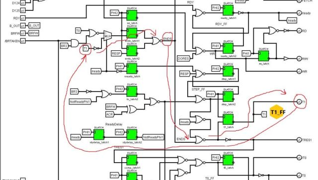

# MOS 6502 Core

MOS 6502 processor core emulator on the gate level.

Yeah, it's that simple. We take the 6502 logic circuits from Wiki and just duplicate them in C++.

To understand what's going on here, it's enough to understand how circuits work. The code simply repeats their work.

## Approaches to simulation

Some modules are simulated immediately with output values. And for some, simulation and output values are separated for convenience.

In general, the source code is a bit like Verilog, but unlike the latter, we choose the sequence of execution of circuit elements ourselves,
thereby imitating the propagation delay that we have in real circuits.

If the module has few inputs/outputs, they are passed as parameters. If there are a lot of inputs/outputs, an array indexed by enum definitions is used as a parameter.

## Combinatorial and sequential circuits

As you know, there are two types of circuits: simple unidirectional gate cascades (NOR, NAND) and cyclic (sequential) Flip/flops circuits.

Combinatorial circuits are simulated simply by repeating the operation of the gates. No gimmicks.

The following approach is applied to sequential circuits (FF's):
- The input stage uses the stored FF value (`ff.get`)
- The output stage updates the current FF value (`ff.set`)
- This makes no difference between which elements the FF is based on. It can be 2 closed inverters, 2 closed NOR or any other cyclic closure
- The "storage" location of FF on the cyclic circuit is chosen arbitrarily, but usually closer to the FF output

It should be noted that the 6502 has quite a few hidden and quite twisted loops, for example:



## Buses

Modules connected to internal buses require a special approach and a certain order of execution, as written here:
https://github.com/emu-russia/breaks/blob/master/BreakingNESWiki_DeepL/6502/context_control.md

You should also consider the case when several sources (e.g. registers) put their values on the same bus at the same time.
To solve such situations ("bus conflicts") it is necessary to use the "Ground wins" rule.

This takes into account the 6502 feature where buses are "precharged" during PHI2. This is required to form constants (e.g. stack address, interrupt address). Charging is done at the very beginning of the simulation.

## Optimization

The M6502Core can, with some stretch, be called suitable for real-time applications.

The following approaches are used for optimization:
- Separation of PHI1/PHI2 phases by if/else
- Precomputing combinatorial logic with tables (see e.g. predecode.cpp).
- Packing of bus and register bits into uint8_t, avoids for loops on all bits
- High level logic circuits simulation (see e.g. alu.cpp).

The bottleneck is random logic, which consumes 50-60% of computing time.

Besides, now both parts are simulated 2 times every half cycle, to stabilize latches.

## Optional ExactPacked backend

The two-argument constructor keeps the reference implementation. An explicit
third argument selects the exact packed implementation for the NES core mode:

```cpp
M6502Core::M6502 cpu(true, true, M6502Core::ExecutionBackend::ExactPacked);
```

`GetExecutionBackend()` reports the effective selection. ExactPacked currently
requires both HLE and the BCD hack; other combinations use Reference. The empty
constructor and virtual `sim` interface used by FakeM6502 remain available.
Construction selects the backend; there is no runtime state conversion.

The packed decoder indexes the original product terms by the opcode byte and
six independent timing bits. All 16,384 binary combinations are retained,
including unusual timing combinations. Each 32-byte row contains three 64-bit
decoder masks and factorized register, ALU and flag descriptors. The shared
table occupies 512 KiB; it is allocated on the heap to avoid a large temporary
on the Windows stack. Packed construction creates no generic decoder PLA or
per-instance Cartesian control tables. Consumers read the masks directly;
legacy decoder debug values are expanded only when requested.

The backend uses typed control evaluators and masked command writes in the
original producer order. Both Top/Bottom settling passes remain, with one
precharge and the original ground-wins dirty-bus handling per public call.
The phase optimization omits only proven inert calls: operand loads, accumulator
bus stores and PC loads in PHI2, the repeated stack-output refresh already done
earlier in PHI2, and the HLE PC increment in PHI1. ALU input/output control
helpers with no PHI1 effect also return early. These are phase guards, not
separate compile-time PHI1/PHI2 kernels; further specialization remains an
optimization opportunity. No physical phase, external bus response or settling
pass is skipped.

`CpuKernelTests.cpp` independently reconstructs the original decoder inputs
and compares every output for all opcode/timing keys, then checks every live
descriptor combination against the scalar control tables. It also checks the
command-word bit layout, fresh public debug records, all 256 opcodes across
four operand/flag cases, memory side effects, held phases, reset/RDY/SO/IRQ/NMI,
public getters/setters and physical 0/1/X/Z pads. Per-call comparisons observe
the chip's returned data before the memory fixture responds. Debug preserves
the reference exceptions for invalid NOT inputs. This establishes bounded
equivalence to the retained simulator; it does not establish new hardware
conformance for undocumented instructions.

Release and Debug private proofs passed on Apple Clang 21 ARM64. The source
also passes a C++14 public-header consumer check; the library implementation
and its VS2026 project use C++17. Native Windows execution is unverified.

The final [nine-pair CPU campaign](../../UnitTest/FastSim/results/appleclang21-arm64-v3-cpu.json)
measured 845.289 ms for the frozen reference CPU and 342.404 ms for ExactPacked,
a median paired speedup of 2.4707x with nine wins and equal checksums. Full
Release, Debug and ASan+UBSan validation passed on the final shared snapshot.

Three alternating full-second development samples of the initial packed
checkpoint measured 2.3802x over the original CPU using the same active scalar
benchmark, with equal checksums. The later routing/row/commit ablation had
possible contention near its end and is not acceptance evidence. The 24-byte
row (`M6502_PACKED_SMALL_ROW=1`) and single RandomLogic command commit
(`M6502_PACKED_SINGLE_COMMIT=1`) passed correctness checks but showed no clear
benefit in that pilot; both defaults remain zero. Final performance conclusions
belong to the isolated FastSim campaign with its recorded build identities.

## Fourth pass (v4, 2026-10-14): the two settling traversals

The v4 CPU track kept the public contract and the Reference backend untouched and
reworked how the ExactPacked backend performs its two Top/Bottom settling
traversals. Each public call still precharges once (PHI2), clears the dirty
flags once and runs Top -> Bottom -> Top -> Bottom; what changed is which blocks
have anything left to do in the second traversal and how the phase is known.

- **Measured first** (`-DM6502_PASS2_STATS`, extended): in PHI2 the second Bottom
  traversal changes bus state in 38.8% of calls even when the command word, the
  wires Bottom reads and the external data byte are identical (99.8%): the ALU
  result computed in the first traversal reaches SB/ADL in the second and the
  SB/DB/ADH connect muxes converge. A general "skip Bottom2 if its inputs are
  unchanged" rule is therefore unsound and was rejected. The second Top traversal
  changes state in 60-80% of calls (dispatcher/BRK/ACR-fed wires, and in PHI1 the
  decoder row itself, because the T-state latches are transparent in PHI1).
- **The five command evaluators run once per call.** RegsControl, ALUControl,
  PC_Control, BusControl and FlagsControl read only inputs that are frozen for the
  whole phase or settled by the first traversal; the signals that do settle in
  PHI1 (T0, T1, BRFW, flags, the row) reach them only inside PHI2-enabled blocks.
  Their second evaluation rewrites every latch and command bit with the value it
  already holds, except `AVR_V`, the live decoder line d[112], which the replay
  refreshes from the current row. `-DFASTSIM_SKIP_ORACLE` re-runs them and aborts
  on any difference (`RandomLogic::sim_ReplayOracle`).
- **Derived decoder lines.** The 29 static products of decoder lines the evaluators
  formed per call (n_MemOp, STOR, REST, the ENDX/WR static terms, JB, IND,
  IMPLIED, ABS_2, n_SB_AC, n_AC_SB, ...) are precomputed per row into bits
  130..158 of the third row word (`DerivedLine`); the row stays 32 bytes.
  `CpuKernelTests` re-derives all of them from the independently simulated PLA
  lines for every one of the 16,384 keys. The disabled small-row layout is
  excluded by a `static_assert` because it would overlap the third word.
- **Compile-time phases.** The ExactPacked call dispatches on the PHI0 pad: Zero
  selects Phase-1 kernels, One Phase-2 kernels, any other pad value the generic
  Phase-0 kernels, which keep the reference's run-time phase expressions
  verbatim. `Phi<Phase>` (core.h) turns every `DLatch::set(value, PHI1/PHI2)`,
  `PHI2 == One`, `if (PHI2)`, `if (PHI1)` and `NOR(latch, PHI2)` into its
  compile-time form, so the compiler removes the gate cones that only feed latches
  whose enable is low in the selected phase. No data representation changed.
- **The PHI1 second Bottom traversal is skipped when it is provably the identity.**
  Enumerating every state Bottom writes against every read of that state within
  Bottom leaves four PHI1 feedback paths (P_DB pushing flags that the flag loads
  rewrite later in the traversal; SB/ADH followed by 0/ADH zeroing; SB/DB and
  SB/ADH both active; SB/ADD with 0/ADD), plus the wires WR, T1, BRK6E and B_OUT
  that the second Top traversal may change. `M6502::Phi1BottomIdempotent` and the
  control-signature compare implement exactly that; PHI2 and the generic phase
  always run both traversals. `-DFASTSIM_SKIP_ORACLE` runs the skipped traversal
  anyway and aborts on any change (`M6502::sim_Phi1BottomOracle`); it rejected the
  first, narrower version of the predicate (see the commit history). The skip
  fires on 100.00% of PHI1 calls in the active benchmark.

Per-commit effects on the standalone active CPU benchmark (same harness, paired
alternations against the preceding commit, equal checksums): replay of the five
evaluators 16.6%, derived lines 3.2-3.6%, phase specialization 15.6%, PHI1
Bottom skip 10.2%.

End-to-end development campaign (Apple M5 Max, Apple clang 21, Release/LTO,
P-core QoS pin, pairs alternated back to back, medians, all checksums equal on
both sides; the branch-point binary is the v4 head rebuilt with the identical
harness, the comparator is the pinned v3-chips/v4-harness build):

| Workload | Branch point | Final | Paired speedup |
| --- | ---: | ---: | ---: |
| CPU active (1,789,772 cycles), 5 pairs | 346.9 ms, 96.9 ns/half-call | 212.8 ms, 59.4 ns/half-call | 1.630x (1.587-1.649) |
| CPU active vs comparator, 3 pairs | 350.4 ms | 214.9 ms | 1.631x |
| APU active incl. CPU (5M master cycles), 3 pairs | 262.6 ms | 232.4 ms | 1.130x |
| APU legacy incl. CPU (5M master cycles), 3 pairs | 262.5 ms | 229.3 ms | 1.145x |
| Joined CPU/APU/PPU active, one NTSC second, 3 pairs | 2835.5 ms | 2708.2 ms | 1.047x (1.024-1.060) |

These are development pilots (3-5 pairs), not the nine-pair acceptance campaign.
Validation on the final binary: full `--test`, full oracle `--test`
(`-DFASTSIM_SKIP_ORACLE`), ASan+UBSan `--test-quick`, the seven archived mapper-0
ROMs (all "ROM contract PASS"; reference outcomes 1 PASS / 3 FAIL / 3 TIMEOUT as
before) and the C++14 public-header consumer compile all passed.

## Fourth pass, round 2 (v4r2, 2026-10-14): representation and the settling traversals

Round 2 kept the public contract, the Reference backend and the two settling traversals
per call, and changed what the ExactPacked traversals carry and which of their blocks have
anything left to do. Five commits, one idea each; every omission ships with a
`FASTSIM_SKIP_ORACLE` check that re-runs the omitted work from a snapshot of the same
state and compares every byte of the core.

- **Packed command-latch banks.** The 78 latches of the five command evaluators are one
  bit each in two words on the core, `cmd_latch2` (PHI2-enabled) and `cmd_latch1`
  (PHI1-enabled), holding exactly the DLatch's g. A latch that is the sole source of a
  command bit sits at that command bit's position, so each evaluator's command bits are a
  masked copy of its bank (inverted for the NOT/nget outputs, i.e. everything but ADD_SB7
  and n_ACIN); the PHI2 chain sources sit at their PHI1 copies' positions, so the PHI1
  chain update is `~bank2 & mask`. Each evaluator merges its bank once per traversal
  under the same enable the DLatches had; no evaluator reads a latch of the bank it is
  writing in the same traversal except FlagsControl's acrc/pin (read back as the
  descriptor fields they were set from) and the outputs (formed after the merge). Layout
  and helpers: `random_logic.h`. The replay oracle compares both banks. The Reference
  instantiations are machine-code identical (Regs/Bus/PC/Flags) or differ only by two
  unused reference parameters (ALU).
- **Compile-time phase for the datapath and Top blocks.** Regs::sim_LoadSB/StoreSB,
  ALU::sim_HLE, ProgramCounter::sim_HLE, DataBus::sim_Get/SetExternalBus,
  AddressBus::sim_Output, PreDecode::sim, IR::sim and ExtraCounter::sim_HLE have
  Phase-templated bodies (the `<0>` instantiation is the reference's run-time form,
  called by the public functions); the packed kernels call `<Phase>` and the HLE variants
  directly (ExactPacked requires HLE and the BCD hack; both are set only by the constructor).
- **PHI2 second Top traversal = settle** (`M6502::sim_Phi2TopSettle`). With PHI1 state
  frozen and the row constant in PHI2 (IR is PHI1-latched; the T-state cone is a fixed
  point of its recurrence), the second traversal rewrites every latch with the value the
  first wrote, except through the reads of state the first traversal rewrote *after*
  reading it and the reads of ACR (recomputed by the Bottom traversal in between): ACRL1
  (ACR, acr_latch2), the BRK6E -> B_OUT -> Z_IR cone (brk6_latch2), the predecoder (data
  byte on a write cycle, Z_IR), ENDS (ends_latch1/2), ipc_temp (ACR), and n_TRES1/TRES1,
  tresx_latch2 and n_TRESX downstream. Exactly those are recomputed
  (`Dispatcher::sim_SettlePhi2BeforeDecoder/AfterRandomLogic`, `PreDecode::simImpl<2>`).
- **PHI2 second Bottom traversal = bus drivers only** (`M6502::sim_Phi2BottomSettle`). The
  PC increment (PCLS/PCHS and n_1PC are PHI1 state), the ALU compute (AI/BI are PHI1
  state; the ADD drivers see the first traversal's result either way), the flag latch2
  copies, the external data drive, the address output and the pads rewrite what the first
  traversal wrote; the DL re-latch and every bus driver, the muxes and the constant
  generator still run in the original order (a changed ALU result, a driven data byte and
  the connect muxes legitimately change bus state in the second traversal). A conditional
  skip of the whole second traversal was measured and rejected: exact, but it fires on
  40.3% of PHI2 calls (59.6% re-drive a changed ALU result) and nets 1.0% against an
  inexact upper bound of 6.0%.
- **PHI1 second Top traversal = row and downstream** (`M6502::sim_Phi1TopSettle`). The row
  can re-select (comp_latch1..3, tres2_latch, t1_latch are written late in the first
  traversal; Z_IR follows the settled DORES), so the predecoder, IR, ExtraCounter, lookup,
  branch logic (new flags, DB7) and sim_AfterRandomLogic re-run in full, after
  `Dispatcher::sim_SettlePhi1BeforeDecoder` (n_T0, Z_IR) and
  `BRKProcessing::sim_SettlePhi1BeforeRandom` (BRK5_RDY/BRK7, donmi_latch, n_DONMI).
  Omitted as identities: the pads block, the rest of sim_BeforeDecoder, the rest of
  sim_BeforeRandom (brk6_latch1 and res_latch2 are fixed points of their recurrences over
  PHI2 state), sim_BeforeRandomLogic and BRKProcessing::sim_AfterRandom. Round 1's PHI1
  second-Bottom skip is unchanged.

Rejected by measurement (kept out): `M6502_PACKED_SINGLE_COMMIT=1` on top of the banks
(1.3%), the conditional PHI2 second-Bottom skip (1.0%, above), and a `DecoderView<true>`
that copies the row's three words at construction (neutral, 0.997).

Per-commit effects on the standalone active CPU benchmark (same harness, pairs alternated
against the preceding commit's binary, equal checksums, other tracks active on the
machine): banks 5.9%, phase-templated datapath 6.6%, PHI2 Top settle 12.9%, PHI2 Bottom
settle 5.9%, PHI1 Top settle 5.8%.

End-to-end (Apple M5 Max, Apple clang 21, Release/LTO, P-core QoS pin, pairs alternated
back to back, medians, equal checksums; the branch point is the round-1 merged head
b7f74c5 rebuilt with the identical harness, byte-identical to the frozen round-1 binary):

| Workload | Branch point | Final | Paired speedup |
| --- | ---: | ---: | ---: |
| CPU active (1,789,772 cycles), 7 pairs | 210.2 ms, 58.7 ns/half-call | 146.2 ms, 40.9 ns/half-call | 1.437x (1.422-1.463) |
| CPU active vs comparator (v3 chips, r1 harness), 3 pairs | 344.2 ms | 147.4 ms | 2.323x |
| APU active incl. CPU (5M master cycles), 5 pairs | 190.9 ms | 175.8 ms | 1.091x |
| APU legacy incl. CPU (5M), 3 pairs | 189.4 ms | 174.9 ms | 1.083x |
| APU idle (held clock, no CPU calls), 3 pairs | 32.6 ms | 33.2 ms | 0.984x (noise) |
| PPU active (5M; no CPU code executed), 3 pairs | 292.6 ms | 292.2 ms | 1.002x |
| Joined CPU/APU/PPU active, one NTSC second, 3 pairs | 2173.8 ms | 2096.6 ms | 1.038x (1.034-1.040) |

Development pilots, not the nine-pair acceptance campaign. Validation on the final
binary: full `--test`, full oracle `--test` (`-DFASTSIM_SKIP_ORACLE`: the replay oracle,
the PHI1 Bottom oracle and the three new snapshot/restore oracles ran on every applicable
call), ASan+UBSan `--test-quick`, and the seven archived mapper-0 ROMs (all "ROM contract
PASS"; reference outcomes 1 PASS / 3 FAIL / 3 TIMEOUT as before).
